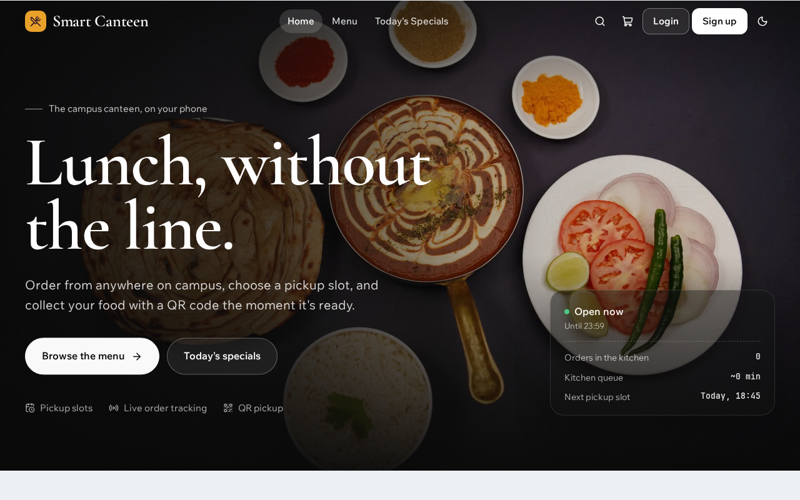
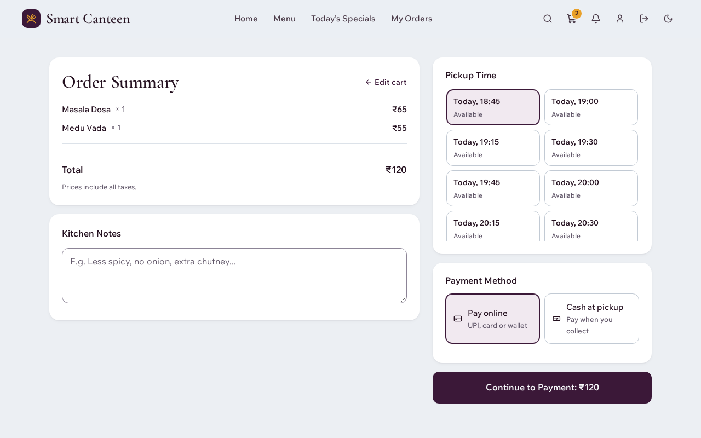
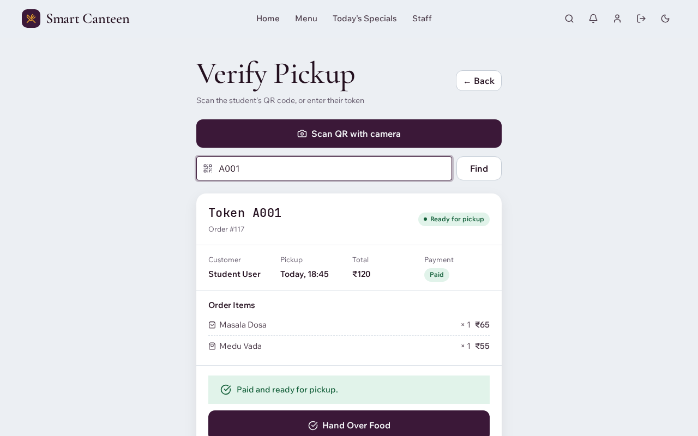
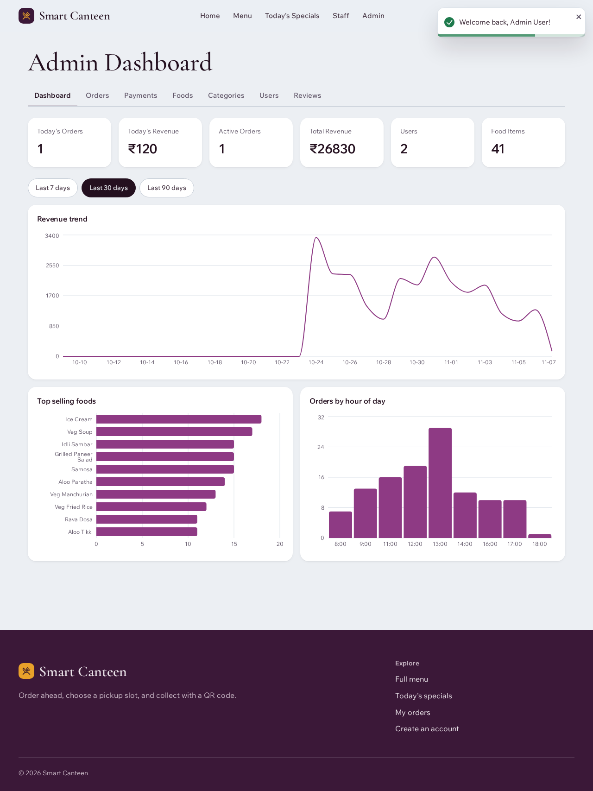
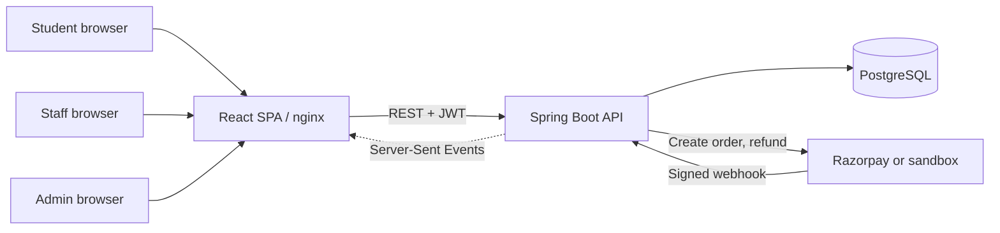
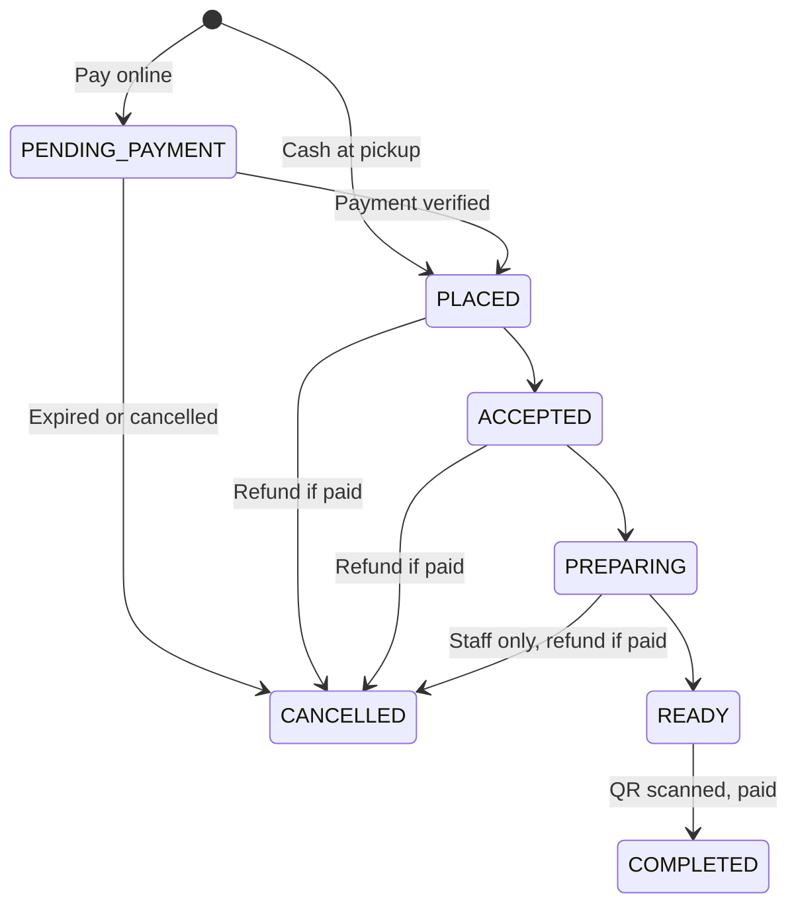
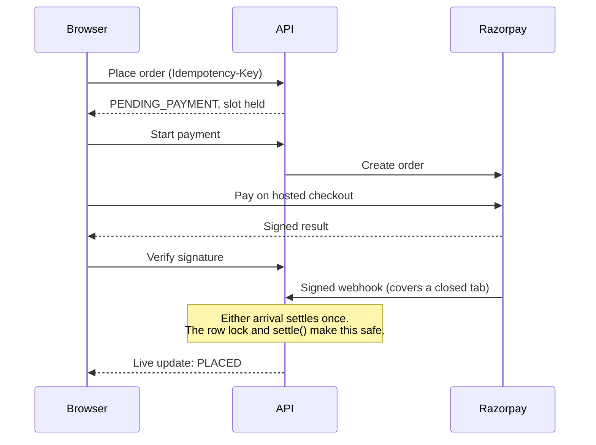

# Smart Canteen

Order ahead, choose a pickup slot, and collect your food with a QR code. A full-stack campus canteen system built with React, Spring Boot and PostgreSQL, focused on correct behaviour under concurrency and failure.

**Live demo:** https://smart-canteen-ruby.vercel.app (Razorpay in test mode, so no real money moves; the backend sleeps when idle and can take a minute to wake up).

| Light | Dark |
|---|---|
|  |  |

| Checkout with pickup slots | Staff pickup verification | Admin analytics |
|---|---|---|
|  |  |  |

## Quick start

Needs only Docker.

```bash
docker compose up --build
```

Open **http://localhost:5173** and use the demo buttons on the login page. Ports can be changed: copy `.env.example` to `.env`.

| Service | URL |
|---|---|
| App | http://localhost:5173 |
| API docs | http://localhost:5173/swagger-ui/index.html |

Demo accounts exist only when demo data is on (`SEED_DEMO_DATA=true`, the local default):

| Role | Email | Password |
|---|---|---|
| Student | student@canteen.com | Student@123 |
| Staff | staff@canteen.com | Staff@123 |
| Admin | admin@canteen.com | Admin@123 |

These are for local use only. The live site doesn't use these passwords.

Payments use a clearly labelled **sandbox** locally, so no account is needed and no money moves. See [Deployment](docs/DEPLOYMENT.md) for Razorpay test mode, and [KT](docs/KT.md) for how the live site is run.

## What it does

**Students** browse and search the menu, choose a pickup slot, pay online or choose cash, track orders live, collect with a QR code, and review what they ate.

**Staff** run the kitchen board with live updates, scan QR codes with a camera (or enter tokens), take cash, and mark items unavailable.

**Admins** manage foods, categories, users, and reviews, monitor payments, and see revenue and peak-hour analytics.

## Engineering highlights

| Problem | Approach | Proof |
|---|---|---|
| **Overbooking** when many students want one slot | Atomic `UPDATE ... WHERE booked < capacity` | 50 concurrent checkouts, 10 places: exactly 10 succeed |
| **Handing food over twice** | Atomic status update as the single gate | 10 concurrent scans: exactly 1 succeeds |
| **Forged pickup codes** | HMAC-signed QR codes, sent only to the owner | Forged and altered codes are rejected |
| **Fake or missed payments** | Signature checks, signed webhooks, idempotent settlement | Replayed, forged and wrong-amount webhooks tested |
| **Double-click at checkout** | `Idempotency-Key` with a unique index | 10 concurrent identical requests: 1 order |
| **Stale kitchen screens** | Server-Sent Events published after commit | Rolled-back changes are never announced |
| **Abandoned checkouts** | Unpaid orders expire and release their slot | Tested with expired orders |

Each decision and its trade-offs are written up in [`docs/adr`](docs/adr).

## Architecture



### Order lifecycle



### Online payment



## Tech stack

- **Frontend:** React 19, Vite, React Router, Bootstrap, Recharts, ZXing (QR scanning)
- **Backend:** Java 17, Spring Boot 3.3, Spring Security, JPA/Hibernate, Flyway, Bucket4j
- **Database:** PostgreSQL 16 in every environment
- **Payments:** Razorpay (test mode), or a built-in sandbox
- **Delivery:** Docker Compose, GitHub Actions, Render, Vercel

## Security

- Public sign-up only creates students, and admins create staff accounts
- BCrypt passwords, JWT auth, and role and ownership checks on every endpoint, tested as a role-by-endpoint matrix
- Disabling a user takes effect on their next request
- Login rate limiting per email and per IP
- No default secrets in production: the app refuses to start without them, or with the sandbox gateway
- Card and UPI details stay on Razorpay's hosted checkout
- Error responses never include internal details

Known limitations are listed in the [interview guide](docs/INTERVIEW.md#known-limitations-say-these-before-youre-asked).

## Testing

```bash
cd backend && ./mvnw verify      # Backend, on real Postgres via Testcontainers (Docker needed)
cd frontend && npm test          # Frontend unit tests
cd frontend && npm run lint

# Browser tests, against the running stack. The higher login limit lets the
# tests log in as the same demo accounts many times a minute.
LOGIN_LIMIT_PER_EMAIL=1000 docker compose up -d --build --wait
cd frontend && npx playwright install chromium && npm run test:e2e
```

Browser tests cover the full order journey across two sessions with live updates, a camera scan using a fake video feed, failed payment retry, refunds, full slots, role access, and phone-width layout. They add data, so reset afterwards with `docker compose down -v`.

## Local development without Docker for the app

```bash
docker compose up -d postgres
cd backend && ./mvnw spring-boot:run                     # http://localhost:8080
cd frontend && npm install && npm run dev                # http://localhost:5173
```

If port 8080 is taken: run the backend with `PORT=8081`, and the frontend with `VITE_PROXY_TARGET=http://localhost:8081`.

## Project structure

```
backend/src/main/java/com/canteen/
  controller/  service/  repository/  entity/  dto/   Core layers
  payment/     Gateway interface, Razorpay, sandbox
  pickup/      Signed QR codes, counter endpoints
  slots/       Pickup capacity, canteen status
  realtime/    Server-Sent Events
  security/    JWT filter, rate limiter
backend/src/main/resources/db/migration/              Flyway migrations
frontend/src/  pages/  components/  context/  services/  utils/
frontend/e2e/  Playwright browser tests
docs/          ADRs, deployment guide, KT (operations), interview guide
```
